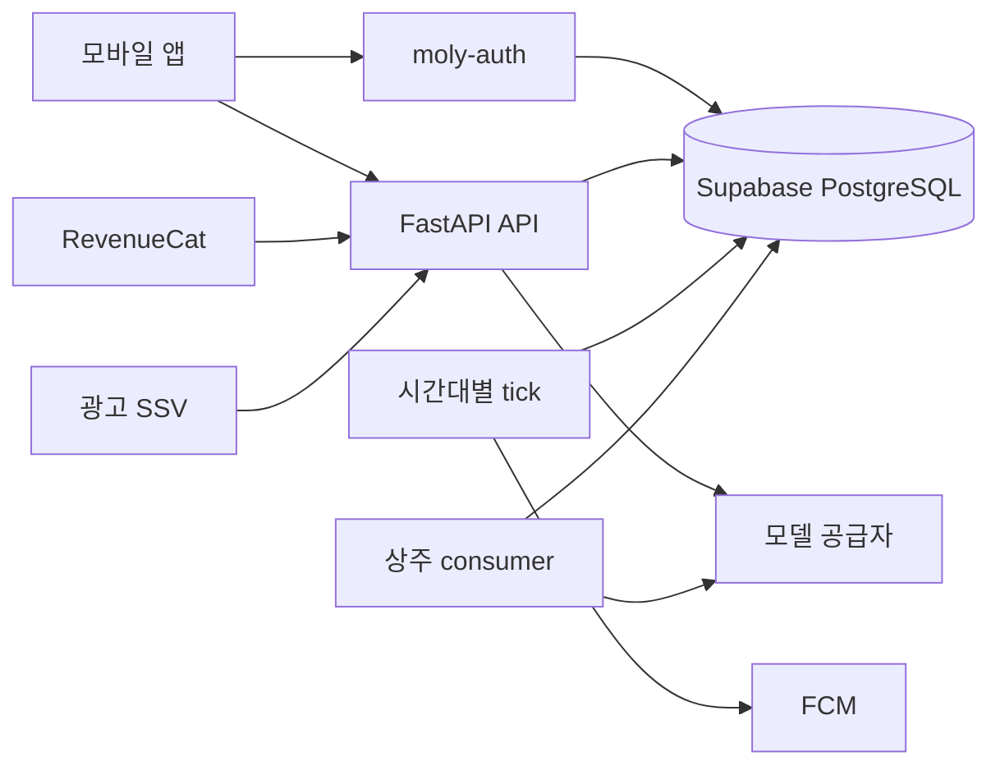

# 백엔드 구조

이 문서는 서비스 경계와 불변 규칙을 설명한다. 배포 상태와 환경별 설정은 [운영](OPERATIONS.md)에서
별도로 확인한다. 정확한 계약은 [OpenAPI](../openapi/openapi.yaml)와 [DDL](../db/schema.sql)이 원본이다.

## 시스템 경계

- `moly-backend`: 대화·일기·감정 기록·루틴·경제·상점·구독·광고·운세·배너·BGM.
- `moly-auth`: 계정·온보딩·프로필 변경·알림/기기 설정·로그아웃·계정 삭제 시작.
  두 서버가 공유하는 DB 함수·프로필·삭제 장벽 계약은 함께 유지한다.
- API는 HTTP JSON 요청·응답을 사용한다. FCM은 별도 푸시 채널이며 기기 도착을 보장하지 않는다.
- API, tick, consumer는 같은 저장소의 별도 프로세스다. tick 실행과 consumer 실행을 서로 대체하지 않는다.

소스: [라우터 등록](../app/main.py), [API](../app/api/), [worker](../worker/).

## 레이어와 소유권

`api → services → models/core` 순으로 의존한다. 라우터는 인증·입력·응답·트랜잭션 경계를,
서비스는 권한과 도메인 정책을, DB는 유일성·참조·원자적 상태 변경을 맡는다.

| 영역 | 기준 소스 | 유지할 계약 |
|---|---|---|
| 대화·기억 | `services/chat.py`, `agent/`, `memory_pipeline.py` | 멱등·턴 lease·외부 호출 분리·발행 재검증 |
| 일기·감정 | `diary.py`, `diary_generation.py`, `mood.py`, `mood_context.py` | 캐피 일기와 사용자 감정 메모 분리 |
| 루틴·보상 | `routine.py`, `routine_day.py`, `economy.py` | 현지 날짜·요일 이력·자연 멱등 |
| 경제·상점 | `hay_ledger.py`, `shop.py` | 원장과 잔액 동시 갱신·서버 가격·소유권 |
| 결제·권한 | `subscription.py`, `entitlement.py`, `gating.py` | 공급자 검증·거래 멱등·체험 출처 구분 |
| 운세 | `fortune.py`, `fortune_catalog.py` | 당일 저장본·광고 해금 보존·문구/계산 분리 |
| 콘텐츠 | `banner_catalog.py`, `topic_entries.py`, `bgm.py` | 서버 카탈로그·조건부 노출·지원 언어 |

경로는 [app/services/](../app/services/) 기준이다. 도메인 상세는 [문서 안내](README.md)로 연결한다.

## 공통 불변 규칙

### 서버 권위와 시간

클라이언트는 DB를 직접 쓰지 않고 서버가 반환한 권한·가격·잔액·한도를 사용한다.
플랜과 체험의 출처는 조회 시 판정하며 서로 다른 출처를 `trial` 하나로 뭉쳐 정책을 정하지 않는다.

| 기준 | 사용자 현지 경계 | 사용처 |
|---|---|---|
| `activity_date` | 04:00 | 대화 한도·일기 귀속 |
| `reward_date`/달력 날짜 | 00:00 | 출석·루틴·광고 보상·운세·현재 감정/기억 시점 표시 |

00:00~03:59에는 두 날짜가 다를 수 있다. `user_daily_stats.activity_date`라는 컬럼명만 보고
모든 도메인의 날짜를 같게 계산하지 않는다. 감정 기록 API는 요청된 날짜를 그대로 보존한다.
소스: [time_utils.py](../app/core/time_utils.py), [app_day.py](../app/core/app_day.py).

### 트랜잭션과 외부 호출

- 대화는 짧은 읽기/예약 → 트랜잭션 종료 → 모델·도구 호출 → 짧은 확정 순서다.
- 사용자별 lease(기한이 있는 처리 권한)·요청 해시·generation을 확인한 뒤 메시지·사용량·멱등 결과·후속 작업을 확정한다.
- 건초는 `hay_transactions`가 원장이고 프로필 잔액은 캐시다. DB 트랜잭션 안에서 함께 바꾼다.
- 광고는 검증된 SSV, 결제는 검증된 공급자 이벤트가 지급 근거다. 클라이언트 완료 콜백으로 지급하지 않는다.

### 언어와 정보 사용

생성 콘텐츠의 지원 언어는 `ko/en/ja`다. 프로필 지역 태그는 기본 언어로 정규화하고 미지원 값은
영어로 폴백한다. API별 명시 언어 입력의 허용 범위는 OpenAPI를 따른다.
대화의 감정 선택값은 오늘의 허용된 5종만 내부 정보로 제공하며 메모·과거 감정은 넣지 않는다.
응답 언어 방어와 사용 권한은 [대화·기억](ARCHITECTURE-capi.md)에 정리한다.

## 비동기 작업과 데이터

- tick은 사용자 시간대에 맞춰 일기·알림 등의 작업을 수행/예약한다. 실행 주기·실제 호스트 역할은
  배포 설정으로 확인하며 코드 기본값으로 운영 활성 상태를 추정하지 않는다.
- consumer는 `async_jobs`의 lease로 작업을 선점하고 완료·재시도·회수한다. 기억, 요약, 일기 회상,
  관계·삭제 후속 처리 등은 등록된 handler가 담당한다.
- 완료 작업의 payload와 멱등 응답 사본은 도메인 원본과 별도 보존·비식별화 정책을 적용한다.
- 큐의 미해결 오류는 `jobs._STATS_SQL`로 판단한다. 성공 replay의 모든 조상을 제외하며 raw dead
  행 수를 현재 장애로 세지 않는다.

소스: [tick](../worker/tick.py), [consumer](../worker/consumer.py), [jobs](../app/services/jobs.py).
테이블 관계는 [ERD](ERD.md)를 따른다.

## 보안과 변경 관리

- 일반 API는 Supabase JWT를 JWKS로 검증한다. 공개 health·설치 귀속·서버 간 웹훅은 각자의 계약을 쓴다.
- 사용자 범위는 인증된 ID로 제한한다. 도구 인자에 사용자 ID·SQL·임의 필터를 허용하지 않는다.
- 도메인 테이블은 RLS와 객체 권한으로 클라이언트 직접 접근을 막는다. 서버 역할의 우회 권한은
  서비스의 소유권 검사·삭제 장벽을 대신하지 않는다.
- 계정 삭제는 `moly-auth`의 장벽 설정으로 시작하며 API·잡 발행에서도 재확인한다. 계정 삭제 후에도
  남겨야 하는 최소 삭제 장벽과 감사 정보는 사용자 콘텐츠와 별도로 취급한다.
- 모델의 출력·도구 결과·저장된 기억은 신뢰된 명령이 아니다. 문자 정제만으로 보안을 보장하지 않는다.
- 키·JWT·연결 문자열·개인 본문을 로그·문서·CI 출력에 넣지 않는다. 개발/운영의 역할·대상·이미지 경계를 유지한다.

DB 적용과 코드 배포는 별개다. 기존 DB에 baseline을 다시 실행하지 않으며, 혼합 버전의 reader/writer
호환과 데이터 보존을 확인한 후 변경한다. [DB 안내](../db/README.md)와 [운영](OPERATIONS.md)을 따른다.
