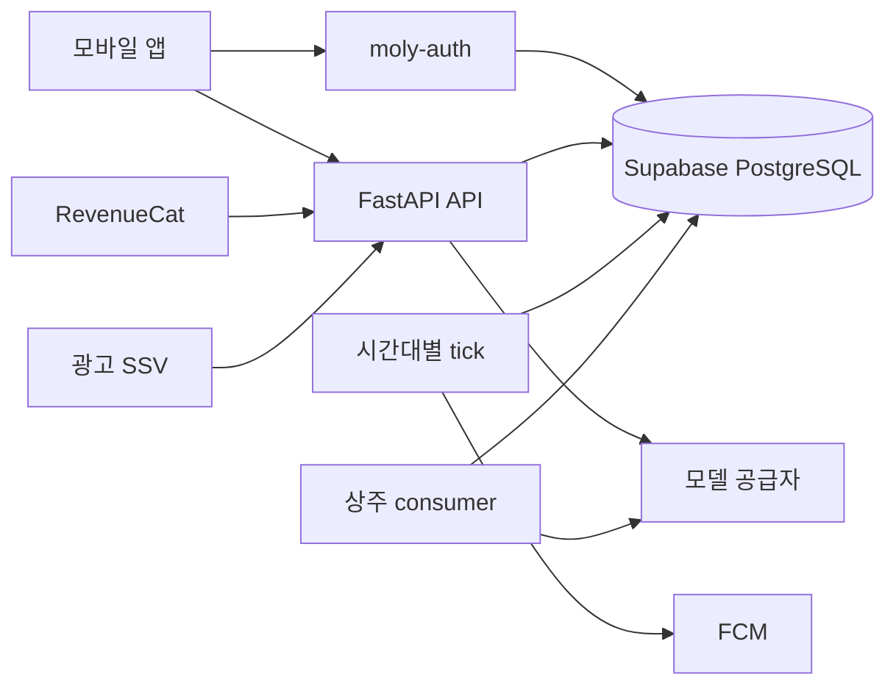

# 백엔드 아키텍처

서버 경계와 대화·기억 처리에서 유지할 계약을 설명한다. 정확한 API·DB 계약은
[OpenAPI](../openapi/openapi.yaml)와 [DDL](../db/schema.sql), 배포·설정 점검은 [운영](OPERATIONS.md)을 따른다.

## 목차

- [시스템 경계](#시스템-경계)
- [레이어와 소유권](#레이어와-소유권)
- [공통 규칙과 시간](#공통-규칙과-시간)
- [턴 처리와 발행](#턴-처리와-발행)
- [입력 컨텍스트와 캐시](#입력-컨텍스트와-캐시)
- [모델과 도구](#모델과-도구)
- [원문 연속성과 요약](#원문-연속성과-요약)
- [장기 기억과 사용자별 상태](#장기-기억과-사용자별-상태)
- [일기 참조·기억 관리·계정 삭제](#일기-참조기억-관리계정-삭제)
- [사용량과 운영](#사용량과-운영)
- [비동기 작업과 데이터](#비동기-작업과-데이터)
- [보안과 변경 관리](#보안과-변경-관리)

## 시스템 경계

- `moly-backend`: 대화·일기·감정 기록·루틴·경제·상점·구독·광고·운세·트레이닝·배너·BGM.
- `moly-auth`: 계정·온보딩·프로필 변경·알림/기기 설정·로그아웃·계정 삭제 시작.
  두 서버가 공유하는 DB 함수·프로필·삭제 장벽 계약은 함께 유지한다.
- API는 HTTP JSON 요청·응답을 사용한다. FCM은 별도 푸시 채널이며 기기 도착을 보장하지 않는다.
- API, tick, consumer는 같은 저장소의 별도 프로세스다. tick 실행과 consumer 실행을 서로 대체하지 않는다.

소스: [라우터 등록](../app/main.py), [API](../app/api/), [worker](../worker/).

## 레이어와 소유권

`api → services → models/core` 순으로 의존한다. 라우터는 인증·입력·응답·트랜잭션 경계를,
서비스는 권한과 도메인 정책을, DB는 유일성·참조·원자적 상태 변경을 맡는다.

| 영역 | 기준 소스 | 유지할 계약 |
|---|---|---|
| 대화·기억 | `chat.py`, `agent/`, `memory_pipeline.py` | 멱등·턴 lease·외부 호출 분리·발행 재검증 |
| 일기·감정 | `diary.py`, `diary_generation.py`, `mood.py`, `mood_context.py` | 캐피 일기와 사용자 감정 메모 분리 |
| 루틴·보상 | `routine.py`, `economy.py` | 현지 날짜·요일 이력·자연 멱등 |
| 경제·상점 | `hay_ledger.py`, `shop.py` | 원장과 잔액 동시 갱신·서버 가격·소유권 |
| 결제·권한 | `subscription.py`, `entitlement.py`, `gating.py` | 공급자 검증·거래 멱등·체험 출처 구분 |
| 운세 | `fortune.py`, `fortune_catalog.py` | 당일 저장본·광고 해금 보존·문구/계산 분리 |
| 트레이닝 | `trainings.py`, `training_catalog.py`, `training_grading.py`, `training_tries.py` | 정답 비공개·요청 id 멱등·AI 채점은 트랜잭션 밖·실패 시 통과 |
| 콘텐츠 | `banner_catalog.py`, `topic_entries.py`, `bgm.py` | 서버 카탈로그·조건부 노출·지원 언어 |

경로는 [app/services/](../app/services/) 기준이다. 도메인 상세는 [문서 안내](README.md)로 연결한다.

## 공통 규칙과 시간

클라이언트는 DB를 직접 쓰지 않고 서버가 반환한 권한·가격·잔액·한도를 사용한다.
플랜과 체험의 출처는 조회 시 판정하며 서로 다른 출처를 `trial` 하나로 뭉쳐 정책을 정하지 않는다.
건초는 `hay_transactions` 원장과 프로필 잔액을 같은 트랜잭션에서 갱신한다. 광고는 검증된 SSV,
결제는 검증된 공급자 이벤트가 지급 근거다. 클라이언트 완료 콜백으로 지급하지 않는다.

| 기준 | 사용자 현지 경계 | 사용처 |
|---|---|---|
| `activity_date` | 04:00 | 대화 한도·일기 귀속 |
| `reward_date`/달력 날짜 | 00:00 | 출석·루틴·광고 보상·운세·현재 감정/기억 시점 표시 |

00:00~03:59에는 두 날짜가 다를 수 있다. `user_daily_stats.activity_date`라는 컬럼명만 보고
모든 도메인의 날짜를 같게 계산하지 않는다. 감정 기록 API는 요청된 날짜를 그대로 보존한다.
소스: [time_utils.py](../app/core/time_utils.py), [app_day.py](../app/core/app_day.py).

생성 콘텐츠의 지원 언어는 `ko/en/ja`다. 프로필 지역 태그는 기본 언어로 정규화하고 미지원 값은
영어로 폴백한다. API별 명시 언어 입력의 허용 범위는 OpenAPI를 따른다.

## 턴 처리와 발행

1. 인증된 사용자와 삭제 장벽, 요청 해시·멱등 결과를 확인한다. 사용자별 lease(기한이 있는 처리 권한)로 겹치는 턴을 제어한다.
2. 프로필·권한·현재 한도·최근 원문·발행 가능한 요약·현재 상태를 읽고 외부 호출 전에 트랜잭션을 닫는다.
3. 선택된 경로가 모델 응답 또는 제한된 도구 실행을 수행한다. 모델/도구를 기다리는 동안 사용자 락이나
   읽기 트랜잭션을 계속 잡지 않는다. 모델 호출의 사용량 원장은 별도 책임이다.
4. 완결성·출력 언어·참조 대상을 검증한다. 빈 답이나 잘린 출력을 정상 답변으로 발행하지 않는다.
5. 확정 시 사용자 락을 다시 얻고 lease·컨텍스트 revision·기억 generation·삭제 장벽을 재검사한다.
   운세·일기 참조도 현재 소유권/공개 상태를 다시 확인한다.
6. 사용자/캐피 메시지·가중 사용량·멱등 결과·후속 작업을 함께 확정하고 lease를 해제한다.

같은 사용자·같은 멱등 키는 같은 요청을 가리킨다. 다른 본문에 키를 재사용하거나 진행 중인 요청을
새 요청처럼 중복 실행하지 않는다. 과거 응답의 replay도 현재 삭제/참조 공개 계약을 우회하지 않는다.
소스: [chat_turns.py](../app/services/chat_turns.py), [멱등 기록 모델](../app/models/idempotency_key.py),
[privacy.py](../app/services/privacy.py), [chat.py](../app/services/chat.py).

## 입력 컨텍스트와 캐시

| 재료 | 취급 |
|---|---|
| 언어별 성격·출력·정보 사용 규칙 | 코드가 소유하는 정적 system 앞부분 |
| 호칭·대화 약속·관계 사실 | 사용자 범위와 유효 상태를 확인해 제공 |
| 최근 원문·선발화 | 확정된 순서·시각·컨텍스트 경계를 보존 |
| checkpoint 요약 | 발행 상태·포함 범위·기억 generation을 확인한 서버 컨텍스트 |
| 현재 시각·앱 상태·오늘 감정·회상 결과 | 변화하는 컨텍스트로 분리하고 필요한 정보만 제공 |
| 도구 결과·기억·요약 안의 텍스트 | 데이터이며 서버 지시나 권한을 대체하지 않음 |

불변 프롬프트 앞에 매 턴 바뀌는 값을 넣어 캐시를 깨지 않는다. 실제 조립 순서는 `chat._build_system`과
`post_message`를 함께 본다. 저장된 문구의 이름 표시는 `naming.to_placeholder`로 바꾸고 제공 시
`naming.render`로 현재 호칭을 복원한다. 사용자 프로필·원래 발화까지 익명 문자열로 저장된다는 뜻은 아니다.

### 시간과 일시 상태

시간·감정의 사용 조건은 모델에 전달하는 프롬프트 규칙이다. 아래의 DB 조회 범위 제한과 코드 출력 검증과는 구분한다.

현재 시각과 과거 메시지의 시각을 구분한다. 과거 발화의 오늘·어제·지금은 당시 기준이다.
배부름·졸림·이동 등의 일시 상태가 계속되거나 끝났다고 단정하지 않고, 시간이 지난 상태를 새로운
질문·조언의 전제로 선제 재사용하지 않는다. 자정만으로 바로 이어지는 화제를 끊지도 않는다.

소스: [turn_context.py](../app/services/turn_context.py), [time_utils.py](../app/core/time_utils.py),
[mem0_recall.py](../app/services/mem0_recall.py).

### 사용자 감정 선택의 정보 권한

- `mood_context.today_block`은 사용자 현지 오늘 날짜의 `kind`만 조회한다. `note`와 과거 날짜는 읽지 않는다.
- 대화에 허용되는 값은 `annoyed/tired/neutral/content/excited`이며 언어별 선택명으로 전달한다.
  다른 값·누락·조회 실패는 `unknown`이다. 기록 API 자체의 허용 값과 대화의 5종 allowlist는 별개다.
- 사용자가 **오늘 앱에서 고른 감정 이름을 명시적으로 물을 때만** 전달된 선택명을 답할 수 있다.
  일반적인 기분 질문·피곤하다는 말에는 노출하지 않고 말투·화제·질문 결정에도 사용하지 않는다.
- 현재 발화를 우선한다. 과거 대화에서 들은 선택명을 오늘 값으로 복원하지 않는다.
  `unknown`은 모른다는 뜻이지 기록이 없다는 증거가 아니다. 앱 메모·과거 선택을 아는 것처럼 답하거나
  캐피 일기 조회로 대신하지 않는다.

소스: [mood_context.py](../app/services/mood_context.py), [언어별 정보 권한](../app/services/prompts.py).

## 모델과 도구

[agent/runtime.py](../app/services/agent/runtime.py)는 등록 도구·호출 횟수·동시성·결과 예산·절대 마감을 제한한다.
현재 경로를 항상 별도의 계획 모델과 발화 모델 두 호출로 설명하지 않는다. 코드가 선택한 단발/도구
경로와 실제 호출 내역을 기준으로 확인한다.

도구에는 서버의 `ToolContext.user_id`를 주입한다. 모델은 사용자 ID·SQL·임의 권한 필터를 지정할 수 없다.
조회 기간·행 수·문자 수와 턴 합계 결과 예산을 제한하고, 잘린 결과는 완전한 목록으로 취급하지 않는다.
현재 조회 도구는 일기·루틴이며 기억 회상은 별도의 컨텍스트 경로다.
[registry](../app/services/agent/tools/registry.py)의 제어 도구 목록은 비어 있고 대화형 망각은 제공하지 않는다.
모델이 도구를 골랐다는 이유만으로 DB 변경 권한이 생기지 않는다.

[llm.py](../app/services/llm.py)는 남은 foreground 마감 안에서 요청과 허용된 재시도를 제어한다.
SDK의 숨은 재시도와 애플리케이션 재시도를 겹쳐 전체 마감을 넘기지 않는다. 실패 시 무조건 다시 호출하지
않으며 취소/실패 원장을 정리한다. 확정되지 않은 실제 공급자 비용은 `unknown_usage`로 남을 수 있다.

트레이닝 주관식 채점은 같은 `llm.py`로 `model_training_grade`를 부른다. 10초 foreground 마감을 주고 DB
트랜잭션 밖에서 호출한 뒤, 잠금을 다시 잡고 단계·기회를 재확인해 저장한다. 실패·마감 초과·형식 오류는
통과로 처리하고 원장에는 `training_grade` 용도로 남긴다. 계정을 알아볼 정보는 프롬프트에 넣지 않는다.

### 출력 방어

- 프로필의 지원 언어로 답하고, locale의 정상 문자·허용 Latin 이름·사용자 닉네임을 보존한다.
- 허용되지 않은 외국 문자 계열은 실제 코드로 제거한다. 따옴표 안이라는 이유로 필터를 면제하지 않는다.
- 제거 결과가 의미 문자 없는 부호만 남으면 빈 답으로 처리한다. 미완성·빈 답은 `AI_UNAVAILABLE`로
  종료하며 정상 답변처럼 발행하지 않는다.
- 채팅의 줄바꿈·인용·의미 있는 대시는 보존한다. 단어를 보고 평서문에 물음표를 임의 삽입하지 않는다.
  채팅 정제 옵션을 일기 공용 정제의 기본 동작과 혼동하지 않는다.

소스: [text_clean.py](../app/services/text_clean.py), `chat._clean_reply`, `llm.require_completed_text`.
이 방어가 자연스러움이나 모든 내용 안전성을 보장하는 것은 아니다.

## 원문 연속성과 요약

원문은 [messages](ERD.md#대화와-컨텍스트)가 기준이다. 최근 구간은 서버 상한 안에서 보존하고,
checkpoint의 실제 coverage와 남은 원문을 연결한다. 발행되지 않은 요약이나 다른 사용자·generation의
요약을 넣거나, 요약이 생겼다는 이유만으로 그 뒤 원문을 누락시키지 않는다. 상한·트리거는 설정과
[checkpoint_repo.py](../app/services/checkpoint_repo.py), [checkpoint.py](../app/services/checkpoint.py)를 따른다.

요약은 원문을 대체한 새 사실이 아니라 파생 데이터다. 재추출·삭제·발행 경쟁에서는 generation과
privacy epoch를 확인해 오래된 작업이 새 컨텍스트를 덮어쓰지 못하게 한다.

## 장기 기억과 사용자별 상태

| 단계 | 책임 |
|---|---|
| 턴 등록 | `memory_pipeline`이 순서·source/ingest/consolidation 진행 위치를 기록 |
| 추출 | 사용자 발화의 근거를 붙인 후보와 후보별 source 저장 |
| 통합 | 중복·대체·모순을 반영해 registry의 유효 상태 결정 |
| 벡터 저장/삭제 | 공급자 상태와 registry를 연결하고 실패한 삭제는 후속 처리 |
| 회상 | 사용자 범위와 registry 상태로 필터한 결과만 대화에 제공 |

벡터 검색 결과만으로 현재 사실을 판정하지 않는다. provider 삭제가 지연돼도 registry에서 배제된 기억은
회상에서 제외한다. `ambiguous`는 없다는 뜻이 아니며 불확실성을 보존한다. 오래된 기억보다 현재 발화가
우선이고, 서버가 직접 소유하는 장착/루틴 상태는 조회된 서버 값과 구분한다.

기억 행은 메시지별 출처·source_turn_seq·revision을 가지며, 다른 사용자의 근거와 연결하지 않는다.
재처리 세대는 `memory_pipeline_states.repair_generation`, 요약 발행 세대는 `chat_contexts.memory_generation`으로 검사한다. 회상 실패는
대화의 보조 정보 실패로 다루고 모른다는 사실을 숨기거나 기억을 지어내지 않는다.
사용자별 대화 약속과 관계 상태는 별도 구조화 상태이며 임의의 자유 서술 하나로 덮어쓰지 않는다.
소스: [memory_pipeline.py](../app/services/memory_pipeline.py), [mem0_recall.py](../app/services/mem0_recall.py),
[worker/mem0_jobs.py](../worker/mem0_jobs.py), [contract_repo.py](../app/services/contract_repo.py).

## 일기 참조·기억 관리·계정 삭제

캐피가 쓴 공개 일기와 사용자의 감정 메모를 분리한다. 대화 안의 일기 카드는 서버가 소유권·현재
공개 상태를 재검증한 본문이며 모델이 만든 요약을 원문으로 표시하지 않는다.
`X-Moly-Capabilities: diary-reference-v1`을 보낸 클라이언트만 확장 계약을 사용하고, 카드를 제공한
것만으로 읽음 처리하지 않는다. 삭제·비공개 대상은 본문 없는 `unavailable`로 내린다.

관리 경로의 기억 삭제·재추출은 의미 상태·근거·provider 삭제·진행 위치를 함께 다룬다. 계정 삭제는 `moly-auth`의
`begin_subject_deletion` 장벽에서 시작한다. 메시지·일기·요약·벡터·참조·잡 payload·멱등 응답 사본까지
추적하며, 단순 프로필 CASCADE만으로 외부 저장소 삭제 완료를 선언하지 않는다.
소스: [privacy.py](../app/services/privacy.py), [privacy_jobs.py](../worker/privacy_jobs.py),
[chat_references.py](../app/services/chat_references.py), [DDL](../db/schema.sql).

## 사용량과 운영

사용자 한도는 실제 호출 내역을 바탕으로 한 **가중 토큰**이고 실제 USD 원가는
`ai_usage_ledger`·유효시점별 `ai_price_catalog`의 별도 계산이다. 실패/미확인 원가를 0으로 만들지 않는다.
일기 발행의 대화량 조건은 사용자 문자수이며 한도 토큰과 같은 단위가 아니다.

배포/롤백·원장 점검은 [운영](OPERATIONS.md)을 따른다. 기능 플래그·모델·지연 한도는 코드 기본값과
환경별 실제 설정을 구분한다. 특정 운영값이나 대화 품질 개선 실적을 이 문서에서 선언하지 않는다.

## 비동기 작업과 데이터

- tick은 사용자 시간대에 맞춰 일기·알림 등의 작업을 수행/예약한다. 실행 주기·실제 호스트 역할은
  배포 설정으로 확인하며 코드 기본값으로 운영 활성 상태를 추정하지 않는다.
- consumer는 `async_jobs`의 lease로 작업을 선점하고 완료·재시도·회수한다. 기억, 요약, 일기 회상,
  관계·삭제 후속 처리 등은 등록된 handler가 담당한다.
- 완료 작업의 payload와 멱등 응답 사본은 도메인 원본과 별도 보존·비식별화 정책을 적용한다.
- 큐의 미해결 오류는 `jobs._STATS_SQL`로 판단한다. 성공 replay의 모든 조상을 제외하며 raw dead
  행 수를 현재 장애로 세지 않는다.

소스: [tick](../worker/tick.py), [consumer](../worker/consumer.py), [jobs](../app/services/jobs.py).
테이블 관계는 [ERD](ERD.md)를 따른다.

## 보안과 변경 관리

- 일반 API는 Supabase JWT를 JWKS로 검증한다. 공개 health·설치 귀속·서버 간 웹훅은 각자의 계약을 쓴다.
- 사용자 범위는 인증된 ID로 제한한다. 도구 인자에 사용자 ID·SQL·임의 필터를 허용하지 않는다.
- 도메인 테이블은 RLS와 객체 권한으로 클라이언트 직접 접근을 막는다. 서버 역할의 우회 권한은
  서비스의 소유권 검사·삭제 장벽을 대신하지 않는다.
- 계정 삭제는 `moly-auth`의 장벽 설정으로 시작하며 API·잡 발행에서도 재확인한다. 계정 삭제 후에도
  남겨야 하는 최소 삭제 장벽과 감사 정보는 사용자 콘텐츠와 별도로 취급한다.
- 모델의 출력·도구 결과·저장된 기억은 신뢰된 명령이 아니다. 문자 정제만으로 보안을 보장하지 않는다.
- 키·JWT·연결 문자열·개인 본문을 로그·문서·CI 출력에 넣지 않는다. 개발/운영의 역할·대상·이미지 경계를 유지한다.

DB 적용과 코드 배포는 별개다. 기존 DB에 baseline을 다시 실행하지 않으며, 혼합 버전의 reader/writer
호환과 데이터 보존을 확인한 후 변경한다. [DB 안내](../db/README.md)와 [운영](OPERATIONS.md)을 따른다.
