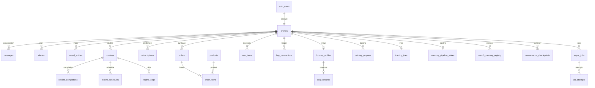

# 데이터 모델

정확한 컬럼·타입·기본값·CHECK·FK·인덱스·함수·트리거·RLS·권한은
[schema.sql](../db/schema.sql)이 원본이다. [schema_contract.json](../db/schema_contract.json)은
DDL에서 생성하는 검증 산출물이며 직접 편집하지 않는다. ORM만 보고 DB 구조를 재작성하지 않는다.

## 관계 개요

다이어그램은 주요 관계만 표시한다. 전체 FK는 DDL에서 확인한다.

## 공통 제약

- `profiles`는 Auth 사용자에 속하고 다수 도메인 행은 사용자 삭제에 연동된다. 삭제 장벽과 외부
  벡터 등의 예외가 있으므로 CASCADE만으로 전체 삭제를 완료했다고 판단하지 않는다.
- 같은 사용자 안에서만 원문·기억·일기 참조를 연결한다. 복합 FK나 사용자 조건을 생략하지 않는다.
- `user_daily_stats`는 사용자와 날짜로 유일하지만 호출 기능에 따라 04시 또는 00시 기준일을 쓴다.
  컬럼명 `activity_date`를 모든 기능의 공통 오늘로 해석하지 않는다.
- 누락·미확인 값의 NULL을 0이나 무료로 바꾸지 않는다. 가격·결제액·시점·공개 상태의 의미를 보존한다.

## 계정과 프로필

| 테이블 | 책임·주요 제약 |
|---|---|
| `auth.users` | Supabase 관리 계정. 앱이 설치한 가입 트리거의 계약은 저장소 DDL에서 관리 |
| `profiles` | 언어·시간대·호칭·체험 시각·잔액 캐시. 가입 트리거로 생성하고 언어는 `ko/en/ja`로 정규화 |
| `user_notification_settings` | 아침 일기·저녁 대화 설정. 종류별 내부 플래그와 사용자 설정을 구분 |
| `user_devices` | 기기 토큰과 활성/무효화 상태. 비밀값과 실제 토큰을 문서·로그에 쓰지 않음 |
| `app_config` | 서버 정책용 JSON 설정. 코드 기본값과 환경의 실제 행은 구분 |

계정 API는 `moly-auth`가 소유한다. 체험 자격은 가입/앱/스토어 체험 출처와 실제 구독을 구분해 판정하며
프로필 한 컬럼이나 `trial` 문자열만으로 전체 권한을 복제하지 않는다.

## 경제와 구독

| 테이블 | 책임·주요 제약 |
|---|---|
| `hay_transactions` | 건초의 원장. 거래 후 잔액과 주문 연결을 보존; 프로필 잔액은 원장과 함께 갱신 |
| `attendance_streak_seeds` | 연속 출석이 이어받은 루틴 연속. 사용자당 1행, 첫 출석 체크 때 어제까지의 루틴 연속·최장 연속으로 고정 |
| `user_daily_stats` | 토큰 누적·일일 보상·알림 선점. 사용자/도메인 기준일 유일. `affirmation_acknowledged_at`은 쓰지 않는 컬럼(오늘의 글귀 확인은 앱 기기 저장) |
| `products` | 서버 상품 카탈로그·에셋 버전·구독 전용 조건. `price_hay=NULL`은 비매품 |
| `orders`, `order_items`, `payments` | 주문·상품 항목·실결제를 구분하고 공급자 거래 중복 반영 방지 |
| `user_items` | 보유와 슬롯별 장착. 구매/권한 및 아이템 소유자를 검증 |
| `subscriptions` | 공급자 이벤트에 따른 구독 기간·상태·스토어 체험 |
| `subscription_hay_grants` | 구독 혜택 최초 지급·환수의 중복 방지 |
| `revenuecat_events` | 웹훅 inbox·처리/보류 상태. 수신과 실제 권한 반영 완료를 구분 |
| `subscription_trial_codes`, `subscription_offer_claims` | 체험/오퍼 발급·소비 기록. 플랫폼·이전 자격 정책 보존 |
| `reward_ad_sessions` | 건초 광고 SSV 세션·거래 멱등 |

금액·가격·체험 기간의 운영값은 [구독](SUBSCRIPTIONS.md)과 해당 환경의 Store/설정을 확인한다.
알림 선점 시각은 발송 중복을 막는 표식이지 실기기 수신 증명이 아니다.

## 대화와 컨텍스트

| 테이블 | 책임·주요 제약 |
|---|---|
| `greetings` | 아직 메시지로 확정하지 않은 선발화와 확정 메시지 연결 |
| `messages` | 단일 연속 대화 원문·발화 순서·종류·시각·사용량. 대화 한도와 이력 범위를 구분 |
| `chat_active_turns` | 사용자별 진행 중인 턴 lease·멱등 키 |
| `chat_contexts` | 원문 구간의 anchor·revision·기억 generation·확정 활동 시각 |
| `idempotency_keys` | 요청 해시·응답 사본·reply 연결과 보존/비식별화 기한 |
| `conversation_checkpoints` | 요약 본문·원문 coverage·발행 상태·generation |
| `chat_response_references`, `conversation_focus` | 공개 일기 카드와 이어지는 대상. 삭제/비공개 시 본문 제거 |
| `user_topic_states`, `chat_topic_entries` | 배너 주제 제안·질문 준비·첫 답변의 멱등 연결 |

소유권·lease·generation·삭제 장벽은 발행 직전 다시 확인한다. 메시지 ID만으로 다른 사용자 원문을
연결하지 않는다. 자세한 처리 순서는 [대화·기억](ARCHITECTURE.md)을 따른다.

## 기억과 사용자별 상태

| 테이블 | 책임·주요 제약 |
|---|---|
| `memory_pipeline_states` | 사용자별 source/ingest/consolidation 진행 위치·privacy epoch·재추출 generation |
| `mem0_ingest_candidates`, `mem0_ingest_candidate_sources` | 추출 후보와 사용자 원문 근거 |
| `mem0_memory_registry`, `mem0_memory_sources` | 의미 상태·대체/충돌·공급자 삭제 상태와 근거 연결 |
| `vecs.moly_memories_v2` | 검색용 벡터. registry의 provider ID와 연결하며 유효성의 원본이 아님 |
| `user_interaction_contracts`, `user_interaction_contract_items` | 구조화된 대화 약속과 발화 근거 |
| `relationship_events`, `user_relationship_states`, `relationship_profile_renders` | 관계 이벤트·결정적 상태·언어별 표시 |
| `user_schedules` | 사용자 일정 상태 |

공급자 벡터 삭제가 늦어져도 registry에서 배제한 기억은 검색 결과에서 제외한다. 기억과 요약의
시점·출처·불확실성을 지우거나 저장 시각을 현재 사건의 증거로 취급하지 않는다.

## 일기·감정·루틴·운세

| 테이블 | 책임·주요 제약 |
|---|---|
| `diaries` | 공개 일기·종류·귀속일/표시일·읽음·삭제 상태. 사용자별 일간/환영 일기 중복 방지 |
| `moly_life_ments` | 운영자 원고. 날짜별 기록과 주간 순서 키를 구분 |
| `diary_gen_claims`, `diary_generation_results` | 생성 선점과 성공/미발행 결과 |
| `diary_recall_documents`, `diary_claim_sources` | 검색용 일기 파생본과 실제 근거 |
| `mood_entries` | `(user_id,entry_date)` 유일. 사용자 감정과 메모; 대화의 5종 제한 조회와 별개 |
| `routines`, `routine_schedules` | 루틴·soft delete·유효일부터의 요일 이력 |
| `routine_completions`, `routine_skips` | 현지 달력 날짜별 완료/스킵. 동일 날짜 중복 방지 |
| `routine_template_categories`, `routine_templates` | 선택 가능한 루틴 템플릿 |
| `fortune_profiles`, `daily_fortunes` | 입력 revision과 사용자별 현재 날짜 snapshot·별도 해금 상태 |
| `fortune_ad_sessions` | 당일 운세 SSV 세션·검증 거래 |
| `daily_affirmations` | 날짜별 오늘의 글귀(ko/en/ja). 운영자가 직접 넣고, 오늘 이하 가장 최근 날짜의 문장을 낸다 |
| `bgm_tracks` | 원격 음원 카탈로그·노출/권한 정보 |

감정 메모를 캐피 일기나 장기기억으로 자동 간주하지 않는다. 운세 문구 버전 변경만으로 유효한 당일
저장본을 재생성하거나 광고 해금을 잃지 않는다. 실제 공개 범위는 [운세](DAILY-FORTUNE.md)를 따른다.

## 트레이닝

| 테이블 | 책임·주요 제약 |
|---|---|
| `training_progress` | 트레이닝별 지금 풀 차례(`next_stage`, 끝내면 NULL과 완료 시각)와 마지막 제출의 요청 id·판정 |
| `training_answers` | 통과한 단계의 답. 보기 id와 쓴 글(200자 이하) 중 정확히 하나 |
| `training_rewards` | 돌아보기 단계 보상 지급 기록. 사용자·트레이닝·단계마다 한 번 |
| `training_tries` | 계정당 도전 기회(0~5)와 충전 기준 시각. 행이 없으면 5개 |
| `training_claims` | 사용자가 보낸 채점 이의. 판정은 바꾸지 않음 |

단계·보기·정답은 DB가 아니라 [원고 카탈로그](../app/resources/trainings/catalog.json)에 있다. 저장된 답이 보기 id를
가리키므로 공개 뒤에는 트레이닝 id·단계 번호·보기 id를 바꾸지 않는다. 통과하지 못한 답의 글은 이의로 직접
보낸 경우 말고는 저장하지 않는다. 다섯 테이블 모두 프로필 삭제에 연동해 지워진다.

## 작업·원가·삭제

| 테이블 | 책임·주요 제약 |
|---|---|
| `async_jobs`, `job_attempts` | dedup·lease·재시도·성공 replay 계보와 시도 이력 |
| `ai_usage_ledger`, `ai_price_catalog`, `ai_usage_daily_rollup` | 모델 호출 원가·시점별 단가·일별 집계. unknown을 0원으로 취급하지 않음 |
| `provider_backoffs` | 공급자 제한/오류 시 재호출 제어 |
| `privacy_subject_barriers`, `privacy_ledger_events` | 삭제 차단과 최소 처리 기록. 계정 삭제 뒤에도 장벽을 식별할 수 있어야 함 |
| `feedback` | 사용자 문의. 원문과 번역 전달 정책은 서비스/운영 계약을 따름 |
| `schema_migrations` | 과거 이력 호환. 현재 구조의 단일 원본으로 사용하지 않음 |
| `shadow_prompt_traces` | 선택적 진단 저장 구조. 테이블 존재가 현재 수집 활성화를 의미하지 않음 |

## 보안과 구조 변경

- 애플리케이션 테이블의 RLS·GRANT·함수 실행 권한은 DDL로 검증한다. 클라이언트 직접 도메인 쓰기를
  열지 않는다. Supabase Auth 관리 객체 전체를 앱 소유라고 간주하지 않는다.
- 외래 키 없는 provider 벡터와 삭제 장벽은 의도된 경계다. 삭제 시 원본·파생본·캐시·잡 사본을 함께 추적한다.
- 기존 DB에 `schema.sql`을 재적용하거나 `seed.sql`로 운영 카탈로그를 덮지 않는다. 변경 SQL의 타입·NULL·
  기본값·잠금·혼합 버전 호환을 검토하고 구조 검증을 통과시킨다.
- 삭제·롤백을 위해 정상 사용자 원문·당일 운세·광고 해금·지급 이력을 임의 초기화하지 않는다.

세부 절차는 [DB 안내](../db/README.md)와 [운영](OPERATIONS.md)을 따른다.

### 트레이닝 요청 기록

`training_submissions`: PK(user_id, training_id, request_id), stage, payload_hash, lease_token, lease_until, result(jsonb), created_at. 사용자별 advisory lock으로 선점하고 AI 호출 전 commit한다. 결과와 기회 차감은 동일 트랜잭션에서 기록한다. 실패 답 원문은 보관하지 않으며 profiles FK CASCADE, RLS 및 service_role 권한을 적용한다.
